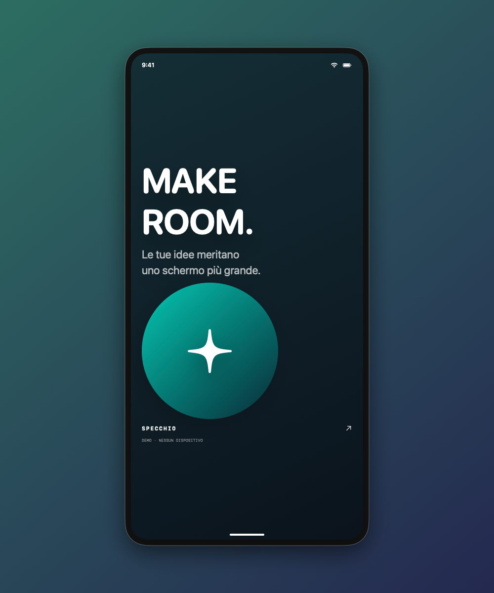

# Specchio Studio

Porta lo schermo di iPhone e iPad sul Mac e prepara screenshot e video da condividere.

**1.3.1 · build 7** · macOS 14+ · Mac Apple Silicon · SwiftUI e framework nativi

<p align="center">
  
</p>

USB, ricevitore wireless in una finestra, registrazione H.264/HEVC e strumenti per comporre contenuti sul Mac. OCR e composizione vengono eseguiti localmente, senza account o servizi cloud.

## Cosa puoi fare

- Mostrare iPhone/iPad via USB o tramite il ricevitore AirPlay dedicato; acquisire anche finestre e schermi del Mac.
- Registrare il flusso originale in MOV H.264 o HEVC, con audio della sorgente quando disponibile.
- Preparare screenshot con sfondo, cornice generica, rotazione, specchio, annotazioni e OCR locale.
- Esportare video con sfondo, cornice e taglio temporale, conservando l’audio.
- Scegliere **Automatico**, **Verticale 9:16**, **Quadrato 1:1** o **Orizzontale 16:9** per screenshot e video. I preset video producono 1080×1920, 1080×1080 e 1920×1080 pixel, adattando la sorgente senza ritagliarla.

L’immagine demo è un’illustrazione generata dal canvas incluso nei test (`.build/test-results/demo.png`). Le registrazioni dirette mantengono il formato della sorgente; la composizione si applica dopo il salvataggio con **Incornicia video**.

## Report, privacy e pacchetti creator

- **Crea segnalazione bug:** inserisci titolo, passaggi e risultati attesi/osservati; ottieni screenshot, composizione annotata, testo OCR e report Markdown/JSON in una cartella pronta da allegare. L’immagine non oscurata è esclusa per impostazione iniziale, con un’opzione esplicita per includerla.
- **Oscura dati:** disegna rettangoli opachi oppure verifica i suggerimenti OCR locali per email, telefoni e possibili chiavi. Le aree vengono applicate ai pixel delle immagini esportate e al testo OCR. Nel pannello video puoi definire maschere separate, applicate per l’intera clip.
- **Pacchetto creator:** genera in una sola operazione tre immagini o tre video (9:16, 1:1, 16:9), una copertina con titolo facoltativo e un riepilogo dei file. Le annotazioni delle immagini seguono il contenuto nel cambio di proporzioni. Gli originali restano separati.
- **Stili personali:** salva e riapplica sfondo, cornice, orientamento, specchio, zoom e formato. Gli stili non contengono immagini, maschere o testo riconosciuto.

Le maschere video sono aree fisse e non seguono dati che si spostano. Il rilevamento suggerisce possibili dati sensibili, senza garantire che siano tutti individuati. Verifica il risultato prima di condividerlo. Registrazioni originali, audio e campi scritti nel report non vengono oscurati automaticamente. I pacchetti vengono pubblicati nella cartella scelta soltanto quando tutti i file sono pronti; annullamento o errori eliminano i soli file temporanei dell’operazione.

## Compilare e avviare

Servono gli Apple Command Line Tools con `swiftc`, `clang` e gli strumenti standard di macOS, più Python 3 disponibile come `python3`.

```sh
./build.sh
open "Specchio Studio.app"
```

Le dipendenze native sono incluse in `ThirdParty/` e collegate staticamente. Per ricompilare anche OpenSSL dai sorgenti inclusi, con Perl e make disponibili:

```sh
./Native/build_crypto.sh
./build.sh
```

La build locale usa una firma ad hoc e **non è notarizzata**. L’icona geometrica è riproducibile dal codice incluso con `swift scripts/generate_icon.swift`.

## Usare lo Studio

1. **USB:** collega e sblocca il dispositivo, autorizza il Mac, poi scegli **Rileva USB → Connetti**. Consenti Fotocamera e, se richiesto per l’audio, Microfono.
2. **Wireless:** premi **Wireless**. Sul dispositivo apri **Centro di Controllo → Duplica schermo → Specchio Studio** e inserisci il codice mostrato quando richiesto. Per iniziare usa la stessa rete Wi-Fi.
3. **Crea:** scegli un **Formato** nel pannello Composizione. Esporta uno screenshot, oppure registra e apri **Incornicia video** per comporre il filmato. La scala degli screenshot moltiplica la risoluzione del preset.

Una sola finestra per processo può attivare il ricevitore wireless. La registrazione viene finalizzata quando termina il flusso. [LEGGIMI.txt](LEGGIMI.txt) contiene le istruzioni complete.

## Verifica e limiti

```sh
./test.sh
# Compilare senza eseguire:
./test.sh --build-only
```

I test usano fixture sintetiche e producono risultati in `.build/test-results`. Un ambiente che blocca i servizi codec di macOS può impedire l’esecuzione: usare un normale Terminale con accesso ai servizi locali.

Il [resoconto delle verifiche](VALIDAZIONE.txt) distingue i test della versione corrente dalle prove con iPhone fisico del **17 ottobre 2026**. iPad fisico, sessioni prolungate, più dispositivi e variazioni di orientamento durante la registrazione richiedono altre prove. Il controllo remoto e l’ascolto audio dal vivo non sono implementati. Il video H.264 composto non supporta la trasparenza; i contenuti protetti possono non essere acquisibili.

## Stato della pubblicazione

Questa versione è preparata per una **revisione locale**. Restano aperte la verifica della provenienza di codice e risorse, la disponibilità del nome e la valutazione della libreria FairPlay usata dal ricevitore: lo stesso [progetto UxPlay segnala un’incertezza legale](https://github.com/FDH2/UxPlay/blob/4e95a9ec013c52d8555d88dbc55abe346e94d56e/README.md#disclaimer). L’inclusione di una licenza open source non certifica tutti i diritti necessari.

[RELEASE_CHECKLIST.txt](RELEASE_CHECKLIST.txt) elenca le verifiche ancora da chiudere. Per preparare pacchetti locali con sorgenti, binario e checksum:

```sh
python3 scripts/release.py
# Solo archivio sorgenti, senza build o test:
python3 scripts/release.py --source-only
```

I pacchetti completi sono in `.build/releases/1.3.1/`; la modalità `--source-only` usa la sottocartella `source-only/`. La preparazione non pubblica nulla e non modifica la cronologia Git esistente. Per distribuire il binario occorre rendere disponibile accanto ad esso il sorgente corrispondente della stessa build.

## Verifica upstream

[UPSTREAM_AUDIT.txt](UPSTREAM_AUDIT.txt) documenta il controllo dei sorgenti ufficiali, le modifiche locali, le correzioni di sicurezza e i limiti della verifica. La cronologia pubblicata contiene un solo commit radice della versione revisionata; backup ed evidenze sono conservati privatamente fuori dal progetto. La riscrittura non cambia la provenienza del codice e non elimina cache del servizio o cloni precedenti.

```sh
# Scarica gli archivi ufficiali mancanti e verifica pin e modifiche dichiarate:
python3 scripts/verify_upstream.py --download
# Ripeti usando soltanto gli archivi già presenti nella cache locale:
python3 scripts/verify_upstream.py --offline
```

La patch 1.3.1 aggiorna libplist a 2.8.0 e OpenSSL a 3.6.5 e aggiunge controlli e test offline per l’abbinamento PIN. Il ramo OpenSSL 3.6 termina il supporto il 1° novembre 2026; il passaggio a un ramo supportato resta da pianificare.

## Licenza

Il progetto dichiara **GPL-3.0-or-later**; i componenti di terze parti conservano copyright e licenze propri. Vedi [LICENSE](LICENSE) e [ThirdParty/NOTICE.txt](ThirdParty/NOTICE.txt). L’app include i testi delle licenze nel menu **Licenze open source**.
