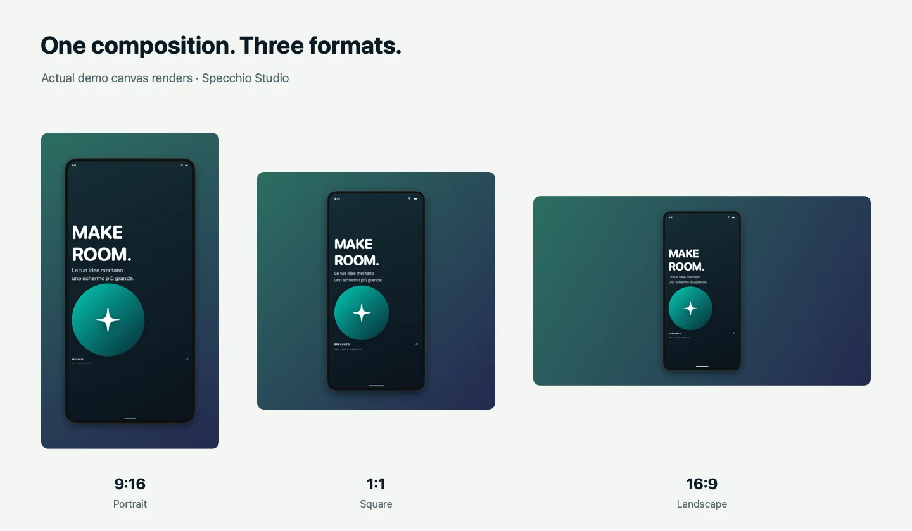

# Specchio Studio

### Your device. Ready to share.

Turn iPhone and iPad captures into **product demos, creator assets and clearer bug reports** on your Mac.

Created by [**Elia Gentili**](https://github.com/eliagentili) · Native macOS app · Local media processing

[Explore the product](https://eliagentili.github.io/specchio-studio-site/) · [Italiano](README.it.md) · [Usage guide](LEGGIMI.txt) · [Verification notes](VALIDAZIONE.txt)

<p align="center">
  
</p>

**Experimental prerelease · 1.3.1, build 7 · Apple Silicon · macOS 14 or later.** Free to download for testing. This is an early release with known limitations and unresolved provenance and legal review; it is not a stable or notarized release.

[**Get the experimental prerelease →**](https://github.com/eliagentili/specchio-studio/releases/tag/v1.3.1-preview.1) — app ZIP, corresponding source archive and SHA-256 checksums.

The app is **ad hoc signed, without Developer ID or notarization**. The local Gatekeeper assessment rejects it; macOS may block a downloaded copy. Read the release notes before downloading. Code and asset provenance, name availability and the receiver's FairPlay status remain under review. Publishing this prerelease does not establish legal clearance.

## One capture. Three useful outcomes.

Capturing the screen is the beginning. Specchio Studio brings the work that follows into one place: framing the result, covering selected details, explaining an issue and exporting the files you need.

| When you need to… | Use Specchio Studio to… | Take away… |
| --- | --- | --- |
| Show what you built | Record, trim, choose a background and add a generic device frame | A composed demo video with source audio when available |
| Prepare content for different layouts | Export a creator package from an image or video | Portrait **9:16**, square **1:1**, landscape **16:9**, a cover and a file manifest |
| Explain a bug clearly | Annotate a screenshot and add reproduction steps, expected and actual results | A local folder with images, OCR text, **Markdown and JSON** reports |

<p align="center">
  
</p>

## Capture, refine, export

- **Bring a screen into the Studio.** Connect an iPhone or iPad over USB or the dedicated wireless receiver, capture a Mac window or display, or import a local image or video.
- **Make it presentable.** Choose backgrounds, a generic frame, rotation, mirroring and composition size. Annotate still images. Save the appearance as a reusable style.
- **Cover selected details.** Draw opaque rectangles or review local OCR suggestions for email addresses, phone numbers and possible keys. Apply confirmed masks to exported images, composed videos and report OCR.
- **Keep media processing on your Mac.** Recording, composition and OCR use native frameworks. No app account or cloud processing service is required.
- **Choose the output for the job.** Record source MOV files in H.264 or HEVC; export composed H.264 video with trimming and source audio when present. Save still images or generate all three creator formats together.

Creator video presets are **1080 × 1920**, **1080 × 1080** and **1920 × 1080**. Image presets use the same base dimensions, with export scaling available. At the default fit setting, source content is fitted into the composition. Recording preserves the source format; framing and privacy masks are applied during the separate composition/export step.

### Privacy controls that you can inspect

Masks replace pixels with opaque areas in the applicable exports. OCR for bug reports reads the masked screenshot. The unmasked original is **excluded from bug-report folders by default** and requires an explicit opt-in.

Review the result before sharing: OCR suggestions can miss sensitive content. Video masks are **fixed rectangles for the full selected clip**, without motion tracking. Original recordings, audio and manually entered report text are not automatically redacted. Image annotations and zoom apply to still exports, not video exports. Saved styles contain appearance settings, not captures, masks or recognized text.

## Build and try locally

Requires an **Apple Silicon Mac running macOS 14+**, Apple Command Line Tools (`swiftc`, `clang`) and Python 3 available as `python3`. Native dependencies are included; Homebrew is not required. The current interface is in Italian.

```sh
./build.sh
open "Specchio Studio.app"
```

The local build uses **ad hoc signing and is not notarized**. To rebuild OpenSSL from the included source, run `./Native/build_crypto.sh` before `./build.sh`; Perl and make are also required.

For USB, unlock the device, trust the Mac and choose **Rileva USB → Connetti**. For wireless, enable **Wireless**, then select **Specchio Studio** from the device's Screen Mirroring menu and enter the displayed code if requested. Start on the same Wi-Fi network. macOS capture permissions depend on the chosen source.

See [the full usage guide](LEGGIMI.txt) for permissions, recording, composition and export. Only one window per process can activate the wireless receiver.

## Built with evidence, still under review

The current 1.3.1 suite passed **23 automated test groups** using synthetic fixtures, including capture/codec paths, wireless pairing regressions, masking, OCR, reports and creator exports. These results cover specific paths, not every device, network or session length.

```sh
./test.sh
# Compile tests without running them:
./test.sh --build-only
```

Results are written to `.build/test-results`. Full tests need access to normal macOS media services. [VALIDAZIONE.txt](VALIDAZIONE.txt) separates current automated checks, earlier UI checks and physical iPhone tests from **17 October 2026**. Those hardware tests have not been repeated on build 7. Current-build iPhone/iPad trials, long sessions, orientation changes, multiple-device scenarios and first launch on another Mac remain open.

The app targets **macOS on Apple Silicon**. Windows, Linux and Intel Mac builds are not provided. Remote device control, live audio monitoring, multiclip editing and video alpha export are not implemented. Protected content may not be capturable.

## Release status, sources and licensing

The first public release is the free **[v1.3.1-preview.1 experimental prerelease](https://github.com/eliagentili/specchio-studio/releases/tag/v1.3.1-preview.1)**. It contains the app ZIP, the corresponding source archive, `SOURCE-INFO.txt` and checksums. Its source snapshot is commit `d6e0bd84f334d3064c0e5e4af163254a08611cf4`; later documentation updates do not change those packaged bytes.

The owner explicitly chose to publish an experimental prerelease with the uncertainties disclosed. Code and asset provenance, name availability, licensing obligations and the receiver's FairPlay dependency remain open: [UxPlay documents legal uncertainty about that library](https://github.com/FDH2/UxPlay/blob/4e95a9ec013c52d8555d88dbc55abe346e94d56e/README.md#disclaimer). Open-source licensing alone does not establish all necessary rights. Developer ID signing, notarization and final hardware validation also remain open. See [RELEASE_CHECKLIST.txt](RELEASE_CHECKLIST.txt).

The project declares **GPL-3.0-or-later**. Third-party components retain their own copyrights and licenses. See [LICENSE](LICENSE) and [ThirdParty/NOTICE.txt](ThirdParty/NOTICE.txt); license texts are also bundled in the app. A distributed binary must be accompanied by the corresponding source for that build as required by the applicable licenses.

| Documentation | Contents |
| --- | --- |
| [LEGGIMI.txt](LEGGIMI.txt) | Complete usage and build instructions |
| [VALIDAZIONE.txt](VALIDAZIONE.txt) | Checks performed, dates and untested scenarios |
| [UPSTREAM_AUDIT.txt](UPSTREAM_AUDIT.txt) | Official-source comparisons, local modifications and audit limits |
| [PROJECT_STATUS.md](PROJECT_STATUS.md) | Architecture and current project status |
| [RELEASE_CHECKLIST.txt](RELEASE_CHECKLIST.txt) | Remaining distribution checks |
| [Launch kit](marketing/LAUNCH.md) | Positioning, demonstration plan and unpublished campaign copy |

Local release packaging is available with `python3 scripts/release.py`; it rebuilds dependencies, tests and builds from an isolated source copy. The prerelease packaging run passed all 23 test groups, the optimized build, ad hoc signature integrity and all **653 source-manifest hashes**. These checks do not establish hardware compatibility, notarization or legal clearance. `--source-only` packages source without validating the app. Packages and checksums are placed in `.build/releases/1.3.1/`. Neither command publishes anything. Upstream comparisons are repeatable with `python3 scripts/verify_upstream.py --download` or `--offline`. The pinned OpenSSL 3.6 branch reaches end of support on **1 November 2026**; migration remains a release-maintenance task.

## A project by Elia Gentili

Specchio Studio brings together native capture, media pipelines and practical export workflows. It is a portfolio project built around a concrete task: helping someone show what they built and explain what needs fixing.

[Explore the product preview](https://eliagentili.github.io/specchio-studio-site/) · [More from Elia on GitHub](https://github.com/eliagentili)
